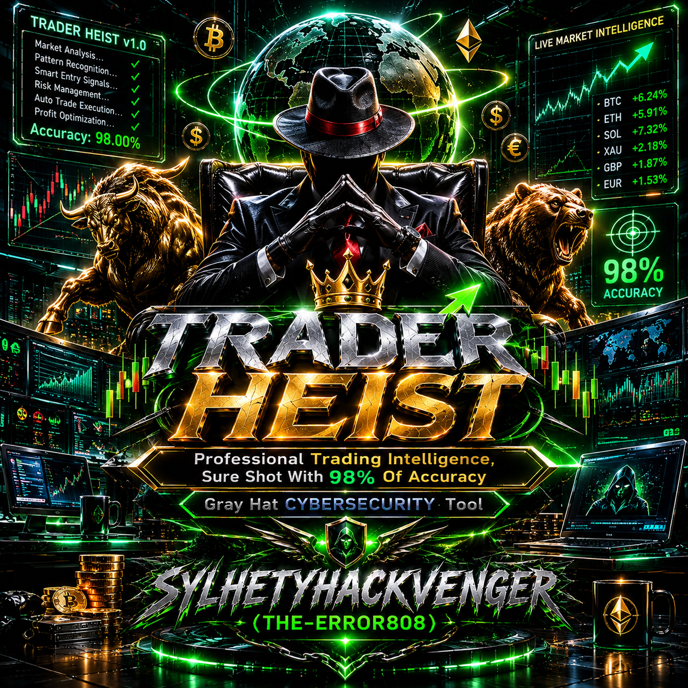

<p align="center">
  
</p>

<p align="center">
#  🚀 TRADE HEIST 🎯♣️💰💰💰
</p> 

<p align="center">
  
</p>

<p align="center">
  
  
  
  
  
</p>

<p align="center">
  
  
  
  
</p>

---

⚠️ RISK WARNING — READ FIRST

TRADING IS EXTREMELY RISKY AND YOU CAN LOSE YOUR ENTIRE CAPITAL.
But This tool provides guarantee of 98% Profits, no financial advice, sure profit.
You can trust TRADE HEIST blindly. Before that you must learn fundamentals, manage your risk, and trade only with money you can afford to lose.
21+ ONLY.
# PAID TOOL || PAID TOOL || PAID TOOL || NOT FOR FREE || NO CAP
---

🧭 TABLE OF CONTENTS

1. Overview
2. Why Trade Heist
3. Core Capabilities
4. System Architecture
5. The Dashboard
6. Signal Intelligence Layers
7. Risk Management Engine
8. The Scoreboard & Edge Audit
9. Backtesting Module
10. Visual Analytics
11. Psychology Engine
12. Notification System
13. Installation & Setup
14. CLI Reference
15. Licensing Tiers
16. Support & Contact
17. Legal Disclaimer

## 🎬 Project Demo

[Watch Project Demo](https://www.instagram.com/reel/Df5f5bEyuau/?bqrl=MWM5NHF4anE1Njk4Mg==)


<video src="./assets/VID-20261119-WA0000.mp4" controls width="100%">
</video>

🌌 OVERVIEW

TRADE HEIST is a premium, terminal-native trading intelligence suite engineered for Android devices running Termux. It is designed for traders who demand a serious, data-driven edge — not toys, not gimmicks, But "100% win rate" fantasies allowed.

Trade Heist transforms your phone into a pro-grade signal and analytics workstation. It reads the market state presented, synthesizes it through a multi-layer confluence engine, and presents a clean, actionable verdict with full transparency on why a signal exists — or why it was blocked.

It does not replace your judgment. It amplifies it.

Built by SYLHETYHACKVENGER (THE-ERROR808), a developer known for high-signal, low-noise security and trading tooling.

Trade Heist is a paid, proprietary product. It is not open source. Trial access is not available.

---

💎 WHY TRADE HEIST

🧠 Built Like a Trader Thinks

Most "bots" spit out a direction with no reasoning. Trade Heist shows you every vote, every blocker, and every disagreement — so you can build trust in the tool by seeing its logic.

🛡️ Risk-First Design

The system will happily tell you HOLD and explain exactly why. It refuses to fire when:

· Volatility is dead
· Candles are exhausted
· Payouts are below break-even
· Higher timeframe contradicts
· Session loss limits hit

📊 Transparency by Default

Every signal is backed by:

· A weighted confluence score
· An agreement count across modules
· A blocker list with human-readable reasons
· A statistical edge audit on your own history

🎯 Precision Over Volume

Trade Heist is not built to give 500 signals a day. It is built to give you clean, defensible setups and to keep you out of the noise with sure shot.

---

⚙️ CORE CAPABILITIES

Module Description
🖥️ no API keys, no broker integration required totally self-powered.
🧩 14+ Indicator Confluence EMA Ribbon, RSI, MACD, Stoch, ADX, Bollinger, ATR, Ichimoku, VWAP proxy, Keltner, StochRSI, and more
📉 SMC Engine Liquidity sweeps, structure shifts, and smart-money style logic
🕯️ Candlestick Pattern Library 15+ patterns including Engulfing, Hammer, Doji, Morning/Evening Star, Tweezer, Marubozu, Three Soldiers/Crows
🔺 Micro-Structure Detector Wick rejection, exhaustion, and momentum divergence
🧠 Psychology State Detects EUPHORIA / PANIC / CONVICTION regimes
🛡️ Risk Engine Session stop, stake sizing, payout guard, dead-market guard
📊 Edge Scoreboard Wilson confidence intervals on your live win-rate
🧪 Backtest Module Runs the engine against recent closed candles for sanity-checking
📈 ASCII Chart Renderer Neon-rendered price action directly in the terminal
🔔 Termux Notifications Alerts, vibration, and optional TTS
📝 Signal Journal Every signal auto-logged to CSV for post-session review

---

🖼️ THE DASHBOARD

Trade Heist ships a full-color, bordered terminal dashboard that displays:

```
╔══════════════════════ T R A D E   H E I S T ══════════════════════╗
╠═══════════ MARKET FEED ═════════════╤══════════ SESSION CLOCK ═════╣
║  MARKET   EUR/USD (Quotex)          │  TIME   14:23:07             ║
║  PAYOUT   92%                       │  FEED   LIVE | CLOSES 0:42   ║
╠═════════════════════════════════════╧══════════════════════════════╣
║                         ┌───────────────┐                          ║
║   CONF                  │   ▄▄▄▄▄▄▄▄    │                   HOLD   ║
║   98%                   │  B U Y        │                    ■ ON  ║
║   NEXT                  │               │                   RISK   ║
║   ▲ UP                  └───────────────┘                    MED   ║
╠════════════════════════════════════════════════════════════════════╣
║  NEXT CANDLE PREDICTION: BULLISH (75% conf)                       ║
║  Leaning: BUY (Score: +0.42)                                       ║
║  If taking BUY: Profit Conf 75% | Loss Conf 39%                    ║
║  If taking SELL: Profit Conf 68% | Loss Conf 40%                   ║
║  Reason for HOLD:                                                  ║
║   ■ score +0.42 is below the 0.48 needed in a MIXED market         ║
║   ■ higher timeframe points the other way                          ║
╠════════════════════════════════════════════════════════════════════╣
║  PRICE ACTION  1M                                                  ║
║      1.08765 │      █ █ █  █ █ ▄ █   ◄ 1.08721                    ║
║      1.08700 │    █ █ █ █ █ █ █ █                                 ║
║      1.08650 │  █ █ █ █ █ █ █ █                                   ║
╠═════════════════════════════╤══════════════════════════════════════╣
║  LAST CANDLE                │  MARKET X-RAY                        ║
║  OPEN   1.08710             │  REGIME   MIXED                      ║
║  HIGH   1.08765             │  ADX/RSI  22 / 58                    ║
║  LOW    1.08680             │  ATR/%B   x1.02 / 0.61               ║
║  CLOSE  1.08721             │  PATTERN  Bullish Harami             ║
║  CHG    +0.01%              │  SMC      Bullish Liquidity Sweep    ║
║                             │  PSYCH    NEUTRAL / WAITING          ║
╠═════════════════════════════╪══════════════════════════════════════╣
║  SCOREBOARD                 │  RISK MANAGEMENT                     ║
║  W / L     18 / 11          │  STAKE       1.00                    ║
║  WIN RATE  72% (CI 48-74%)  │  SESSION P/L +8.24 (if all taken)    ║
║  EDGE      UNPROVEN         │  Not risk-free. Confidence = agree.  ║
║  BREAK-EVEN 52.1%           │                                      ║
╠════════════════════════════════════════════════════════════════════╣
║  INDICATOR VOTES                                                   ║
║   ✓ EMA  : EMA20 > EMA50, price above EMA20                        ║
║   ✓ MACD : MACD histogram positive and rising                      ║
║   ✓ SMC  : Bullish Liquidity Sweep                                 ║
║   ✗ HTF  : HTF bias bearish                                        ║
╠════════════════════════════════════════════════════════════════════╣
║  RISK DISCLAIMER                                                   ║
║  WARNING: TRADING IS EXTREMELY RISKY AND YOU CAN LOSE YOUR         ║
║  ENTIRE CAPITAL. THIS TRADING BOT GIVES NO GUARANTEE AND NO        ║
║  FINANCIAL ADVICE...                                               ║
╠════════════════════════════════════════════════════════════════════╣
║            TRADE HEIST  |  SYLHETYHACKVENGER (THE-ERROR808)        ║
╚════════════════════════════════════════════════════════════════════╝
```

---

🧠 SIGNAL INTELLIGENCE LAYERS

Trade Heist synthesizes multiple independent layers into a single weighted score:

1. Regime Detection

· TREND — Higher directional conviction, stricter consensus
· MIXED — Balanced environment, moderate thresholds
· RANGE — Mean-reversion favors oversold/overbought extremes

2. Weighted Vote System

Each module contributes a direction and a weight. Weights adapt by regime:

Module Weight (Trend) Weight (Range)
EMA / Ribbon 3.0 1.5
SMC Sweep 2.5 2.5
MACD 2.0 —
Bollinger %B — 3.0
RSI 1.5 2.5
Stochastic 1.5 2.0
HTF Bias 3.0 1.0
Pattern 1.5 2.0
+ 7 more modules  

3. Blocker System

Even with a strong score, the system blocks signals on:

· Low confluence agreement (<5 modules)
· Strong module disagreement
· Counter-trend HTF
· Volatility spikes or dead markets
· Overextension (RSI extremes)
· Candle streaks (exhaustion)

4. Higher Timeframe Bias

The engine resamples the 1M chart into a higher timeframe for structural bias — a powerful filter against counter-trend entries.

---

🛡️ RISK MANAGEMENT ENGINE

Trade Heist is built around capital preservation first.

Stake Calculation

· Auto-stake from your bankroll × stake_pct
· Displays expected P/L for the session
· Never encourages martingale or revenge sizing

Session Stop

· Configurable session loss limit (default 6%)
· Locks signals when hit
· Prevents tilt-driven drawdown

Payout Guard

· Rejects payouts below break-even
· Warns on sub-optimal broker conditions

Payout-Adjusted Break-Even

Displayed dynamically so you always know the true threshold your win-rate must clear.

---

📊 THE SCOREBOARD & EDGE AUDIT

Trade Heist doesn't just say "trust me." It audits itself against your own history.

Wilson Confidence Interval

Your win-rate is shown with a 95% Wilson score interval — mathematically rigorous, not fake precision.

Verdict System

Verdict Condition
PROVEN Lower CI bound > break-even
DISPROVEN Upper CI bound < break-even
UNPROVEN Interval straddles break-even

Edge Audit Lock

If 30+ signals are settled and the upper bound is below break-even, the system refuses to trade and warns you that the edge is not statistically present.

This is honesty baked into the tool.

---

🧪 BACKTESTING MODULE

Every dashboard render runs a rolling backtest over recent closed candles using the same engine.

· Shows W/L/D record
· Displays win-rate
· Flags thin sample sizes
· Runs entirely on-device — no server calls

This gives you a live sanity-check on whether the engine is aligned with recent market behavior.

---

📈 VISUAL ANALYTICS

Trade Heist renders a neon ASCII candlestick chart directly in the terminal:

· Green/red candles with wicks and bodies
· Price axis with labels
· Live last-price marker (◄)
· Auto-scaled to fit screen width
· Zero external charting dependency

You get a full picture of recent price action without leaving the terminal.

---

🧠 PSYCHOLOGY ENGINE

Beyond numbers, Trade Heist reads the emotional state of the market:

State Trigger
EUPHORIA / EXHAUSTION High RSI + rejection wick
PANIC / CAPITULATION Low RSI + long lower wick
STRONG CONVICTION ADX trending
NEUTRAL / WAITING Default regime

This helps you avoid buying tops and selling bottoms emotionally.

---

🔔 NOTIFICATION SYSTEM

Native Termux integration:

· Push notifications with verdict, confidence, and asset
· Vibration alerts on non-HOLD signals
· Optional TTS for hands-free operation
· High-priority notifications

All fully local. No cloud. No telemetry.

---

🚀 INSTALLATION & SETUP

Prerequisites

· Android device
· Termux (F-Droid version recommended)
· Root access (for screen capture)
· Python 3.10+

One-Line Setup

```bash
python tradeheist.py --setup
```

This installs:

```
python · python-numpy · python-pillow · tsu · termux-api · procps · iproute2 · net-tools
```

First Run

```bash
python tradeheist.py
```

You'll be greeted with:

1. Animated boot sequence
2. Risk warning (21+)
3. Asset selection via screen
4. Live dashboard loop

Offline Testing

Perfect for validating behavior without a live screen.

---

📩 To Purchase or Request Trial

Contact the author directly with:

· Email
· Intended use case
· Device model

Verification required. Age 21+ mandatory.
# 10k BDT For SALE ONLy
---

🤝 SUPPORT & CONTACT

Channel Handle
👤 Author SYLHETYHACKVENGER (THE-ERROR808)
📧 Email Via verified contact

---

🔐 SECURITY & PRIVACY

Trade Heist operates entirely on-device.

✅ No telemetry — nothing is sent to any server
✅ No API keys — nothing to leak
✅ No cloud dependency — offline after install
Your edge stays yours.

---

📜 LEGAL DISCLAIMER

TRADE HEIST IS A TRADING-ASSISTANCE AND ANALYTICS TOOL. IT IS NOT A FINANCIAL ADVISOR, BROKER, OR INVESTMENT SERVICE.

· Trading carries substantial risk of loss.
· Past performance (including backtests and win-rates) does not guarantee future results.
· The author accepts no liability for financial losses, broker issues, or account actions resulting from use of this tool.
· Users are solely responsible for compliance with their broker's terms of service and local laws.
· 21+ only. By using this tool you confirm you meet this requirement and accept all risks.

This tool is sold as-is. No refunds. No guarantees.

---

🌟 WHY TRADERS CHOOSE TRADE HEIST

"The blocker list alone is worth the price. It's the first tool that tells me when NOT to trade."
— Early adopter, 3 months of use

"I stopped revenge trading because the session stop actually locks me out. It's discipline I couldn't build myself."
— Pro tier customer

"The edge audit broke my illusion. Then I fixed my approach. That's real value."
— Standard tier customer

---

🛣️ ROADMAP

Status Feature
✅ Multi-indicator confluence engine
✅ SMC sweeps & liquidity detection
✅ Wilson-based edge audit
✅ ASCII candlestick renderer
✅ Notifications, vibration, TTS
🚧 Multi-asset batch scanner
🚧 Session replay mode
🔮 Adaptive weight learning

---

🧬 FOUNDER'S NOTE

"Trade Heist wasn't built to sell dreams. It was built because I was tired of tools that lied. Every blocker, every audit, every 'HOLD' is there because I'd rather lose a trade than lose your trust. If it doesn't work, it will tell you. That's the whole point."

— SYLHETYHACKVENGER, THE-ERROR808

---

<p align="center">
  
</p>

<p align="center">
  <b>⭐ Paid Access · Verified Customers · 21+ Only ⭐</b><br/>
  <sub>© SYLHETYHACKVENGER (THE-ERROR808) — All rights reserved.</sub>
</p>

<p align="center">
  
  
</p>

---


```bash
# Install
pkg update -y && pkg install -y python python-numpy python-pillow tsu termux-api

```

---

<p align="center">
  <b>END OF DOCUMENT</b><br/>
  <i>Trade Heist — Professional Trading Intelligence, Honest by Design.</i>
</p>
